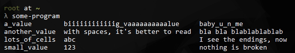

# Gridt

[![License][badge-1-img]][badge-1-link]
[![go.dev][badge-2-img]][badge-2-link]
[![Travis CI][badge-3-img]][badge-3-link]
[![Codecov.io][badge-4-img]][badge-4-link]
[![Go Report Card][badge-5-img]][badge-5-link]

Display contents as a grid in the terminal!

Format unidimensional lists (slices) as grids, with well-defined
columns, suitable for fixed-width fonts, for the sake of readability.

It's both a CLI and a Go library.

Inspired by [ogham/rust-term-grid][1] and by the fact that I needed it
for [paemuri/ipe][2].

## Example

**What we do not want:**


**What we want:**



## Install

### Brew

```sh
brew tap paemuri/packages
brew install gridt
```

### Go

```sh
go install github.com/paemuri/gridt/cmd/gridt
```

## Run

### Default

#### `gridt`

Runs the program with default configuration. It gets the values from
stdin lines.

### Flags

#### `-h` or `--help`

Shows the CLI help message.

#### `-v` or `--version`

Shows the CLI version.

#### `-f <file>` or `--file <file>`

Instead of getting the lines from stdin, gets it from a specific file.

#### `-s <sep>` or `--separator <sep>`

Defines what separates every value column. Defaults to `"  "`.

#### `-d <direction>` or `--direction <direction>`

Defines writing direction. It can be `top-to-bottom` or `left-to-right`.
Defaults to `top-to-bottom`.

## Library usage

```go
// Just create an empty grid...
grid := gridt.New(gridt.TopToBottom, "  ")

// Verify if it fits in a determined width...
dim, ok := grid.FitIntoWidth(100)

// And get its string!
if ok {
  fmt.Print(dim.String())
}
```

```go
// But also, you can do a lot more!

// Create a grid with pre-defined cells...
grid := gridt.New(gridt.LeftToRight, "  ", "cell1", "cell2", "cell3")

// Manipulate the cells...
grid.Add("cell4", "cell5", "cell6")
grid.Insert(2, "cell2.1", "cell2.3")
grid.Delete(0)

// Base the size of the grid on the number of columns,
// instead of the number of caracters...
dim, ok := grid.FitIntoColumns(3)
```

## Source code

The main repository is on [SourceHut][source-srht]. Mirrors exist on
[Codeberg][source-codeberg] and [GitHub][source-github] for convenience, but
they might occasionally be outdated.

## License and contribution

All original code is licensed under the
[Mozilla Public License 2.0][license-code].

Unless you explicitly state otherwise, any contribution intentionally submitted
for inclusion in the work by you shall be licensed under the same license as
the material to which it is contributed, without any additional terms or
conditions.

### License history

Starting with v3.0.0, this project is licensed under MPL-2.0

[1]: https://github.com/ogham/rust-term-grid/
[2]: https://github.com/paemuri/ipe/

[badge-1-img]: https://img.shields.io/badge/license-MPL--2.0-green?style=flat-square
[badge-1-link]: ./LICENSE
[badge-2-img]: https://img.shields.io/badge/go.dev-reference-007d9c?style=flat-square&logo=go&logoColor=white
[badge-2-link]: https://pkg.go.dev/github.com/paemuri/gridt
[badge-3-img]: https://img.shields.io/travis/paemuri/gridt?style=flat-square
[badge-3-link]: https://travis-ci.org/paemuri/gridt
[badge-4-img]: https://img.shields.io/codecov/c/gh/paemuri/gridt?style=flat-square
[badge-4-link]: https://codecov.io/gh/paemuri/gridt
[badge-5-img]: https://goreportcard.com/badge/github.com/paemuri/gridt?style=flat-square
[badge-5-link]: https://goreportcard.com/report/github.com/paemuri/gridt

[source-srht]: https://git.sr.ht/~paemuri/gridt
[source-codeberg]: https://codeberg.org/paemuri/gridt
[source-github]: https://github.com/paemuri/gridt

[license-code]: ./LICENSES/MPL-2.0.txt
